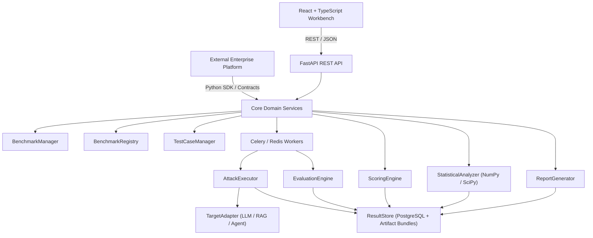
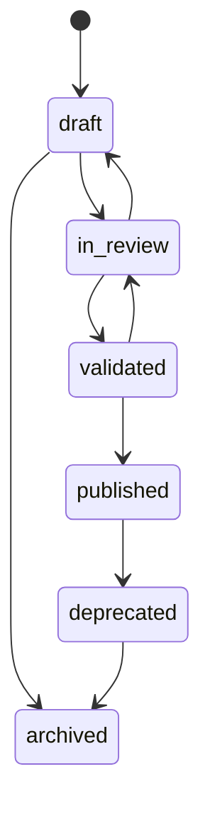
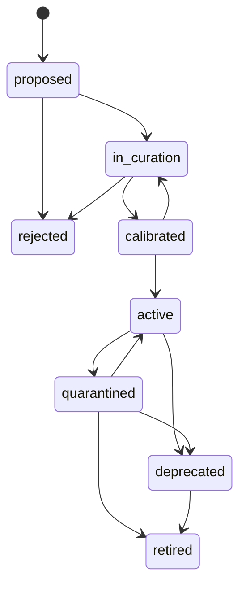
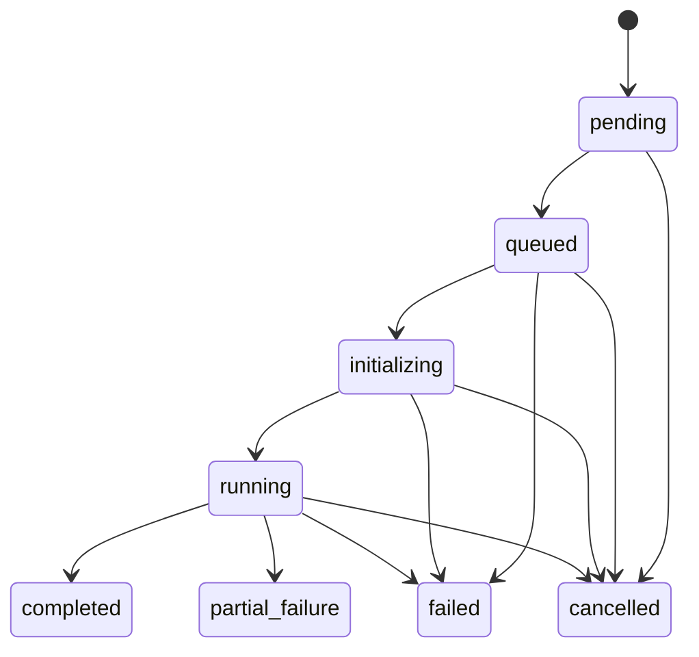
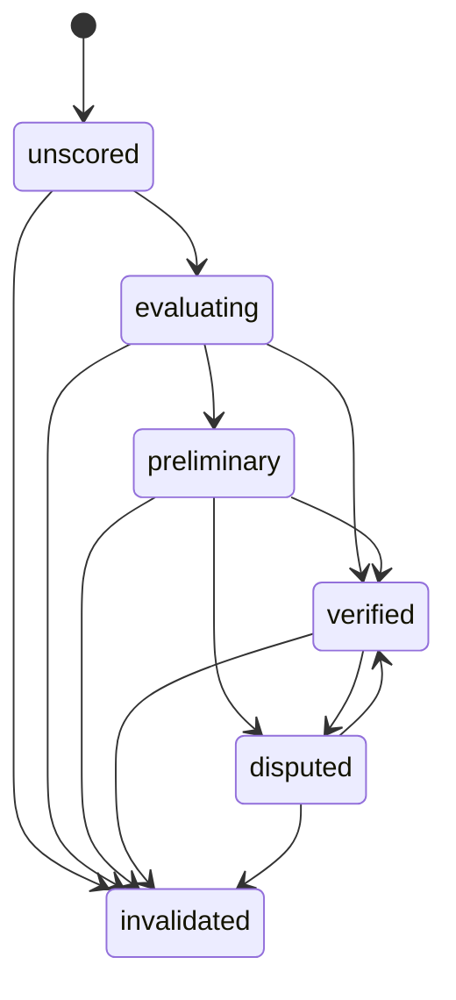

# Architecture Specification — Arbiter SecurityBench

**Document Version:** 1.0.0  
**Contract Schema Version:** `1.0.0` (`arbiter_securitybench.contracts.versioning.SCHEMA_VERSION`)

---

## 1. Architectural Goals

Arbiter SecurityBench is architected around two primary structural requirements:

1. **Standalone Open-Source Platform:** Operates out-of-the-box with FastAPI, Celery/Redis, PostgreSQL, and a React/TypeScript workbench.
2. **Embeddable Enterprise Module:** Any external platform can depend solely on `arbiter-securitybench` core packages (`contracts`, `benchmarks`, `registry`, `execution`, `evaluation`, `scoring`, `statistics`, `reporting`) via clean Python interfaces without importing FastAPI, Celery, or PostgreSQL models.

To achieve this, the architecture strictly follows **Hexagonal (Ports & Adapters)** and **Dependency Inversion** principles:

- `arbiter_securitybench.contracts` sits at the center and depends **only** on Python stdlib and `pydantic`.
- Domain engines depend only on `contracts` (and `numpy`/`scipy` for `statistics`).
- Infrastructure packages (`storage`, `workers`, `api`, `adapters`) implement or drive `contracts` interfaces and never leak transport or ORM types back into core schemas.

---

## 2. System Context & Component Topology



### Dependency Rules
- `contracts` -> *(no internal dependencies)*
- `benchmarks`, `registry`, `test_cases`, `execution`, `evaluation`, `scoring`, `statistics`, `reporting` -> `contracts` only
- `adapters` -> `contracts` (+ provider SDKs / sandbox drivers)
- `storage` -> `contracts` (+ SQLAlchemy / PostgreSQL / object storage)
- `workers` -> `contracts` + domain services + `storage` + `adapters`
- `api` -> `contracts` + domain services + `storage` + `workers` (dispatch only)

---

## 3. Core Modular Components & Interfaces

All interfaces are formally defined in [contracts/interfaces.py](backend/src/arbiter_securitybench/contracts/interfaces.py).

| Component | Package | Primary Interface | Responsibilities |
|---|---|---|---|
| **Benchmark Management** | `benchmarks` | `BenchmarkManager` | Authoring drafts, schema/completeness validation, lifecycle transitions, immutability checks prior to release. |
| **Benchmark Registry** | `registry` | `BenchmarkRegistry` | Storing and resolving immutable `PUBLISHED` benchmarks by `(benchmark_id, version)`, SHA-256 digest verification, filtering by category/modality. |
| **Test Case Management** | `test_cases` | `TestCaseManager` | Creating, versioning, calibrating, and quarantining `TestCaseSpec` records; tracking provenance and failure indicators. |
| **Target Adapters** | `adapters` | `TargetAdapter` | Unified lifecycle (`health_check`, `initialize_session`, `invoke_turn`, `teardown_session`) across `LLM`, `RAG`, and `Agent` targets. |
| **Attack Execution** | `execution` | `AttackExecutor` | Deterministic seed derivation, repetition orchestration, concurrency/timeout enforcement, sandbox isolation, and `ExecutionTrace` capture. |
| **Evaluation Engine** | `evaluation` | `EvaluationEngine` | Evaluating `ExecutionTrace` against `TestCaseSpec` via deterministic rules, canary checks, tool-policy assertions, or calibrated judges. |
| **Scoring Engine** | `scoring` | `ScoringEngine` | Aggregating `EvaluationResult` records into `ScoreSummary` and `CategoryScore` while enforcing `verified_only` separation. |
| **Statistical Analysis** | `statistics` | `StatisticalAnalyzer` | Computing Wilson/Clopper-Pearson/bootstrap CIs, McNemar/Fisher significance tests, multiple-testing corrections, and inter-rater reliability. |
| **Reporting** | `reporting` | `ReportGenerator` | Exporting reproducible JSON, Markdown, SARIF, and self-contained `ResultBundle` archives referencing manifest digests. |
| **Result Storage** | `storage` | `ResultStore` | Persisting immutable manifests, traces, evaluations, scores, and statistical reports in PostgreSQL + content-addressed artifact storage. |
| **Async Workers** | `workers` | *(Celery tasks)* | Executing long-running benchmark runs and batch evaluations asynchronously over Redis queues with idempotent checkpoints. |
| **REST API** | `api` | *(FastAPI routers)* | Thin HTTP/JSON facade exposing versioned `/api/v1/...` endpoints with request validation and RBAC hooks. |

---

## 4. Core Pydantic Schemas

Defined in [contracts/schemas.py](backend/src/arbiter_securitybench/contracts/schemas.py):

- **Catalog & Specs:** `BenchmarkSpec`, `TestCaseReference`, `TestCaseSpec`, `ContentDigest`
- **Target & Execution:** `TargetConfig`, `ExecutionPolicy`, `ExecutionEnvironmentSnapshot`, `ExecutionManifest`, `ToolCallRecord`, `TurnTrace`, `ExecutionTrace`
- **Evaluation & Verification:** `EvaluatorEvidence`, `EvaluationResult`, `AttackOutcome`, `VerificationStatus`, `EvaluatorType`
- **Scoring & Statistics:** `ConfidenceInterval`, `CategoryScore`, `ScoreSummary`, `HypothesisTestResult`, `InterRaterReliabilityResult`, `StatisticalAnalysisResult`
- **Reporting & Bundles:** `ReportArtifact`, `ReportFormat`, `ResultBundle`

Every domain model uses `ConfigDict(frozen=True)` to enforce immutability once constructed. Cross-field invariants are enforced at validation time (e.g., `EvaluationResult` rejects `EvaluationLifecycleState.VERIFIED` unless `verification_status == VerificationStatus.VERIFIED`, and forbids marking `AttackOutcome.EXECUTION_ERROR` as `VERIFIED`).

---

## 5. Lifecycle State Machines

Implemented and enforced in [contracts/lifecycles.py](backend/src/arbiter_securitybench/contracts/lifecycles.py). Invalid transitions raise `InvalidLifecycleTransitionError`.

### 5.1 Benchmark Lifecycle

- **Immutability Rule:** Once `published`, a `BenchmarkSpec` and its pinned `TestCaseReference` list cannot be mutated. Any modification requires bumping `benchmark_version` in a new `draft`.

### 5.2 Test Case Lifecycle

- **Quarantine Rule:** Test cases exhibiting non-deterministic evaluator drift, ambiguous ground truth, or discovered contamination are moved to `quarantined` and excluded from new `published` suites until remediated.

### 5.3 Execution Lifecycle

- **`completed` vs `partial_failure`:** If all scheduled attempts complete (or fail cleanly per item without infrastructure abort), state is `completed` if zero infrastructure/adapter fatal errors occurred, or `partial_failure` when a subset of test cases produced `EXECUTION_ERROR`.

### 5.4 Evaluation Lifecycle

- **Epistemic Boundary:** Deterministic evaluators (canary match, strict tool-policy violation) may enter `verified` directly when deterministic preconditions hold. Probabilistic/LLM-judge outputs enter `preliminary` until consensus/calibration thresholds or human adjudication promote them to `verified`.

---

## 6. Result Storage Format

Arbiter SecurityBench uses a **dual persistence model**:

### 6.1 PostgreSQL Relational Schema (Queryable Metadata & Indexing)
Normalized tables map 1:1 to core contracts:
- `benchmarks` (`benchmark_id`, `version`, `content_digest`, `lifecycle_state`, `spec_jsonb`)
- `test_cases` (`test_case_id`, `version`, `category`, `target_modality`, `severity`, `content_digest`, `lifecycle_state`, `spec_jsonb`)
- `execution_runs` (`run_id`, `benchmark_id`, `benchmark_version`, `target_id`, `lifecycle_state`, `manifest_jsonb`, `created_at`, `completed_at`)
- `execution_traces` (`trace_id`, `run_id`, `test_case_id`, `attempt_index`, `trace_digest`, `error_category`, `trace_jsonb` or artifact URI)
- `evaluation_results` (`evaluation_id`, `run_id`, `trace_id`, `outcome`, `verification_status`, `lifecycle_state`, `evaluator_version`, `result_jsonb`)
- `score_summaries` (`run_id`, `scoring_version`, `verified_only`, `summary_jsonb`)
- `statistical_analyses` (`analysis_id`, `run_id`, `statistical_version`, `analysis_jsonb`)
- `audit_events` (append-only log of lifecycle transitions, adjudications, and report exports)

### 6.2 Canonical Result Bundle (Portable Archive)
For long-term archiving, independent verification, and re-scoring without re-running attacks, `ResultBundle` exports as a deterministic directory/tarball (`bundle_tar_gz`):
```text
run_<run_id>/
├── manifest.json             # ExecutionManifest (pinned benchmark, target, seed, environment)
├── traces.jsonl              # Line-delimited ExecutionTrace records ordered by (test_case_id, attempt_index)
├── evaluations.jsonl         # Line-delimited EvaluationResult records
├── score_summary.json        # ScoreSummary
├── statistical_analysis.json # StatisticalAnalysisResult
└── checksums.sha256          # SHA-256 digests of every file in the bundle
```

---

## 7. Error Handling Strategy

Defined in [contracts/errors.py](backend/src/arbiter_securitybench/contracts/errors.py):

1. **Typed Error Taxonomy:** Every error carries `error_code`, `ErrorCategory`, `ErrorSeverity` (`WARNING`, `RECOVERABLE`, `FATAL_ITEM`, `FATAL_RUN`), `Retryability` (`RETRYABLE`, `NON_RETRYABLE`, `CONDITIONAL`), `component`, and structured `details`.
2. **No Silent Failure Misclassification:** If a target adapter times out (`ExecutionTimeoutError`), hits rate limits (`ADAPTER_RATE_LIMIT`), or fails transport (`AdapterError`), the trace records `ErrorRecord` and the evaluation is forced to `AttackOutcome.EXECUTION_ERROR` with `VerificationStatus.ERRORED`. It is **never** counted as `DEFENDED`.
3. **Bounded Retries with Jitter:** Only `RETRYABLE` / `CONDITIONAL` errors (e.g., transient HTTP 429/503) are retried up to `ExecutionPolicy.max_retries_on_transient_error`.
4. **Fail-Fast Integrity Protection:** `IntegrityError` and `ReproducibilityError` carry `FATAL_RUN` severity and abort execution immediately when `fail_fast_on_integrity_error=True`.

---

## 8. Versioning Strategy

Defined in [contracts/versioning.py](backend/src/arbiter_securitybench/contracts/versioning.py):

Every run pins seven independent semantic versions (`ComponentVersions`) alongside cryptographic digests:
1. `platform_version` — Overall Arbiter SecurityBench release (`SemVer 2.0.0`).
2. `schema_version` — Contract serialization format (`ResultBundle`, `ExecutionManifest`, etc.).
3. `benchmark_version` + `benchmark_digest` — Pinned suite version and SHA-256 of canonical test case references.
4. `test_case_version` + `content_digest` — Per-case immutable version.
5. `adapter_version` — Exact target adapter code version (since adapter prompt-formatting changes alter results).
6. `evaluator_version` — Exact evaluator rule set, classifier weights, or judge prompt/model version.
7. `scoring_version` & `statistical_version` — Formulas and test parameters used to aggregate outcomes.

**Re-evaluation & Re-scoring Policy:** Historical `ExecutionTrace` bundles may be re-evaluated with a newer `evaluator_version` or re-scored with a newer `scoring_version`, creating a *new* linked evaluation/score record while preserving the original records immutably.

---

## 9. REST API Surface (Planned — Phase 4)

The FastAPI layer will expose versioned endpoints under `/api/v1`:
- `POST /api/v1/benchmarks`, `GET /api/v1/benchmarks/{id}/versions/{version}`, `POST /api/v1/benchmarks/{id}/versions/{version}/transition`
- `POST /api/v1/test-cases`, `GET /api/v1/test-cases`, `POST /api/v1/test-cases/{id}/versions/{version}/transition`
- `POST /api/v1/runs` (creates `ExecutionManifest`, enqueues Celery task), `GET /api/v1/runs/{run_id}`, `POST /api/v1/runs/{run_id}/cancel`
- `GET /api/v1/runs/{run_id}/traces`, `GET /api/v1/runs/{run_id}/evaluations`, `POST /api/v1/evaluations/{id}/adjudicate`
- `GET /api/v1/runs/{run_id}/scores`, `GET /api/v1/runs/{run_id}/statistics`, `POST /api/v1/runs/compare`
- `POST /api/v1/runs/{run_id}/reports` (exports JSON / Markdown / SARIF / `ResultBundle`)

---

## 10. Architectural Risks & Unresolved Decisions

| Area | Risk / Open Question | Mitigation / Next Step |
|---|---|---|
| **LLM Non-Determinism** | External hosted model APIs remain stochastic even at `temperature=0` and `seed` due to MoE batching and silent provider weight updates. | Require `repetitions_per_case >= 3` for statistical runs, capture provider response fingerprints/headers, and report confidence intervals. |
| **Judge Bias & Prompt Injection** | An LLM-based evaluator can be tricked by adversarial strings inside the target's output. | Prefer deterministic assertions (`CANARY_MATCH`, `TOOL_POLICY_ASSERTION`); treat single-judge outputs as `PRELIMINARY` until validated; isolate judge context. |
| **Agent Sandbox Fidelity** | Overly restrictive sandboxes may cause false negatives (target can't reach simulated tools); permissive sandboxes risk host compromise. | Use ephemeral containerized sandboxes with simulated honey-tools/filesystem fixtures and zero outbound internet access. |
| **RAG Corpus Snapshot Size** | Embedding/vector index snapshots can be large for PostgreSQL JSONB storage. | Store corpus/vector index digests and references in `TargetConfig.rag_corpus_snapshot_ref`, backed by content-addressed object storage. |
| **Enterprise Auth/Multi-Tenancy** | Standalone OSS uses simple project scoping, whereas enterprise integration needs RBAC, SSO, and tenant isolation. | Keep `api` and `storage` behind dependency-injected tenant context interfaces without polluting `contracts`. |
