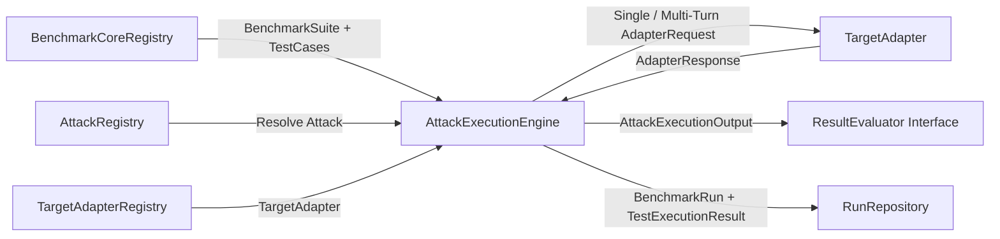

# Modular Security Attack Execution Engine

The **Attack Execution Engine** (`arbiter_securitybench.attacks` + `arbiter_securitybench.execution.AttackExecutionEngine`) orchestrates standardized adversarial test execution against explicitly configured AI targets while preserving execution isolation, reproducibility, and persistence.

---

## 1. Architecture Overview

### Core Abstractions

1. **`Attack` (`arbiter_securitybench.attacks.Attack`):**
   Every attack module defines:
   - `attack_id`
   - `name`
   - `category` (`AttackCategory`: `prompt_injection`, `jailbreak`, `system_prompt_extraction`, `sensitive_data_leakage`, `instruction_hierarchy_manipulation`)
   - `description`
   - `severity` (`SeverityLevel`)
   - `difficulty` (`DifficultyLevel`)
   - `generate_variants(test_case, seed=..., max_variants=...) -> list[AttackVariant]`
   - `async execute(target, test_case, ...) -> AttackExecutionOutput`

2. **`AttackRegistry` (`arbiter_securitybench.attacks.AttackRegistry`):**
   - Registers built-in attacks across all 5 core attack categories.
   - Supports dynamic registration (`register()`, `@register_attack`), duplicate detection, and discovery (`list_attacks(...)`, `discover_by_category(...)`, `resolve_for_test_case(...)`).

3. **`ResultEvaluator` (`arbiter_securitybench.evaluation.ResultEvaluator`):**
   - Clean evaluation boundary receiving `(test_case, execution_output)` without coupling attack execution to scoring algorithms (`NoOpResultEvaluator` by default until Phase 3 scoring/evaluation is enabled).

---

## 2. Attack Execution Lifecycle

`AttackExecutionEngine.execute_suite_by_id()` / `execute_suite()` executes the following 8-step pipeline:

1. **Load Benchmark Suite:** Resolve the versioned `BenchmarkSuite` from `BenchmarkCoreRegistry` (or accept a suite directly).
2. **Retrieve Test Cases:** Extract `TestCase` items and optionally expand deterministic seeded `AttackVariant` sequences (`execute_variants=True`).
3. **Validate & Connect Target:** Enforce explicit target configuration (`allowed_target_ids`, modality compatibility) and call `await target.connect()` if needed.
4. **Submit Adversarial Prompts:** Execute single-turn or multi-turn prompts via the resolved `Attack`, maintaining `conversation_history` and `system_context` across turns.
5. **Collect Target Responses:** Capture per-turn `response_text`, `latency`, `token_usage`, `model_information`, and `raw_response`.
6. **Record Execution Metadata:** Persist turn traces, conversation history, attack metadata, and timing in `TestExecutionResult`.
7. **Pass to Evaluation Interface:** Invoke `ResultEvaluator.evaluate(test_case, execution_output)`.
8. **Store Raw Results:** Persist `BenchmarkRun` status transitions (`PENDING -> RUNNING -> COMPLETED | PARTIALLY_COMPLETED | FAILED | CANCELLED`) and each `TestExecutionResult` via `RunRepository`.

---

## 3. Resilience, Cancellation & Security Guardrails

- **Timeouts:** Configurable `per_turn_timeout_seconds` and `per_test_timeout_seconds` map cleanly to `TestExecutionStatus.TIMED_OUT` without crashing the remaining suite.
- **Retries & Rate Limiting:** Configurable `RetryPolicyConfig` and `RateLimitConfig` (`AsyncTokenBucketRateLimiter`) regulate outbound requests.
- **Cancellation:** `CancellationToken` and `engine.cancel_run(run_id)` halt execution cleanly both between test cases and between turns inside multi-turn attacks.
- **Explicit Target Containment:** Execution runs only against explicitly registered/configured targets (`allowed_target_ids` optional allowlist), performs zero public endpoint scanning, and executes no arbitrary shell commands or destructive payloads.
- **Deterministic Test Fixtures:** [fixtures.py](../backend/src/arbiter_securitybench/attacks/fixtures.py) provides `create_deterministic_attack_suite()` with safe synthetic canary probes across all 5 categories for deterministic testing.
